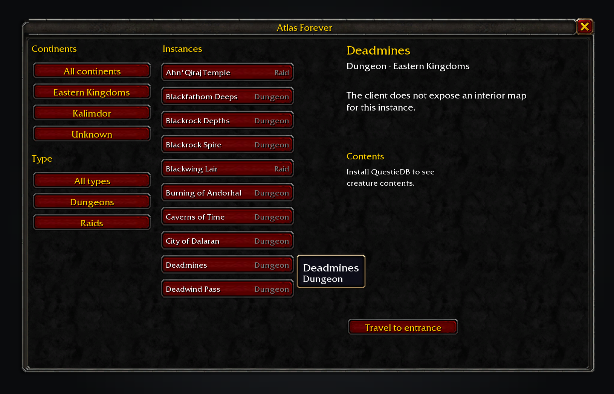

<h1 align="center">Atlas Forever</h1>

Browse the dungeons and raids the client knows, check their available entrance and contents data, and set a waypoint.

## Screenshots

The list shows client-reported instance types and the available travel action.

The selected instance reports that this client build exposes no interior map art or floor names.

Hovering a list row shows its name and type.

## Features

- **Instance index.** Filter by continent or dungeon/raid type, then choose an instance from the client-derived list.
- **Map data.** Atlas records client WDT art IDs. This Forever build exposes no interior UI map layers or floor names, so the window reports that an interior image is unavailable.
- **Contents.** When QuestieDB is installed, Atlas lists creatures whose spawn areas belong to the instance. It does not invent positions or markers.
- **Travel.** Set a client waypoint to an exposed entrance, or send it to Shortest Path Forever when its API is available.
- **Addon API.** `AtlasForever.API` provides a versioned, read-only instance index and an open call.

## Install

Copy `AtlasForever` into `World of Warcraft/_classic_beta_/Interface/AddOns/`. The addon works without any Forever companion. QuestieDB is optional and supplies the creature names and levels.

## Usage

Type `/atlas` or `/atlasforever`, or use the addon compartment entry. Choose a continent and an instance. The entrance button is shown only when the client exposes a usable entrance position.

## Data

Names, types, area membership, entrance positions and WDT asset file IDs come from pinned wago.tools DB2 exports for build `1.60.1.70450`. Level ranges are omitted because the client exports no instance level range. Creature positions are omitted because QuestieDB's spawn-zone records do not provide reliable map coordinates for this view. The export has no UI map art assignments or floor names for these instances.

See [the data limits](docs/data-limitations.md) for the instances without entrance positions and the fields this build does not expose.

## Works alongside

Shortest Path Forever can take an exposed entrance as a dungeon stop. Field Guide and Adventure Guide keep their creature catalogue, quest selection and readiness features. Atlas does not draw on Blizzard's world map or duplicate another addon's pins.

## Development

See [AGENTS.md](AGENTS.md) for the Lua specs, generated-data checks and release gate. Generated inputs and their SHA-256 pins are in `tools/data/` and `tools/pins.json`.

## Credits

Instance data comes from [wago.tools](https://wago.tools/db2) exports of Blizzard's Forever client. Feature ideas were informed by [Shortest Path Forever](https://github.com/cjber/shortest-path-forever), [Legacy Forever](https://github.com/cjber/legacy-forever), and [Bestiary Forever](https://github.com/cjber/bestiary-forever); no sibling code or map values are copied. The build uses no third-party map art.

## Licence

GPL-3.0-or-later. See [LICENSE](LICENSE).
