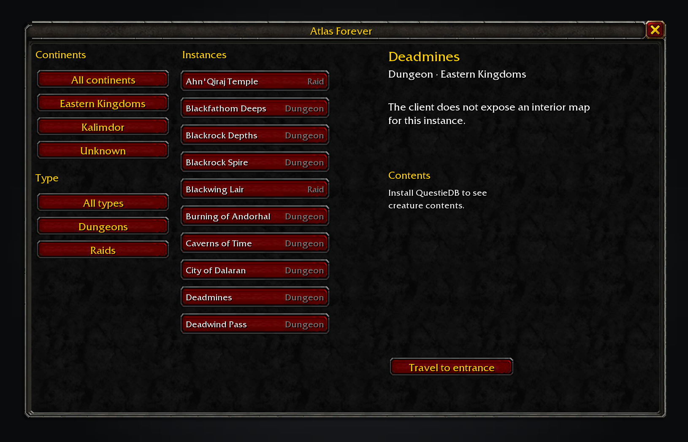
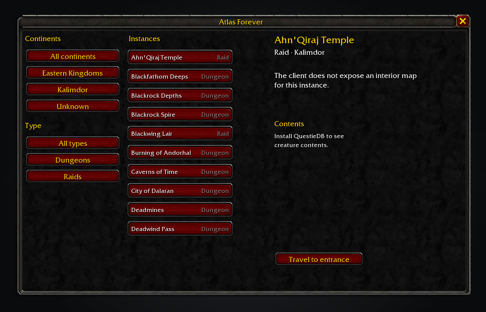

# Atlas Forever

Browse dungeons and raids from one window. Atlas Forever lists client-reported instance names and types, exposes entrance travel when the client has a position, and can show creature names from the optional QuestieDB addon.

Filter the index by continent or instance type, then select an entry.

Atlas reports when the client has no interior map art or floor names.

## Features

- **Instance index.** Filter by continent and browse dungeons and raids.
- **Entrance travel.** Send a client-reported entrance to Shortest Path Forever or set the game's waypoint.
- **Creature contents.** Read NPC names and levels from QuestieDB when installed; positions are not made up.
- **Standalone use.** Atlas works without another Forever addon.

## Usage

Type `/atlas` or `/atlasforever`, or open Atlas from the addon compartment. Select an instance to see what the client reports. This Forever build does not expose interior UI map layers or floor names, so no floor image is shown.

Data is generated from Blizzard's Forever client DB2 exports at wago.tools. QuestieDB data is read at runtime and is not bundled.

Data source: wago.tools and the installed QuestieDB tables. Licence: GPL-3.0-or-later.
